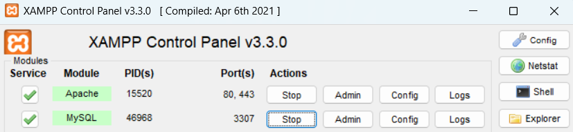
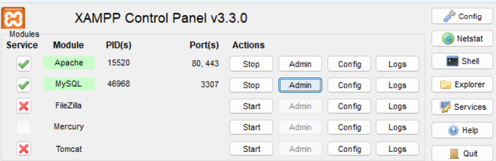
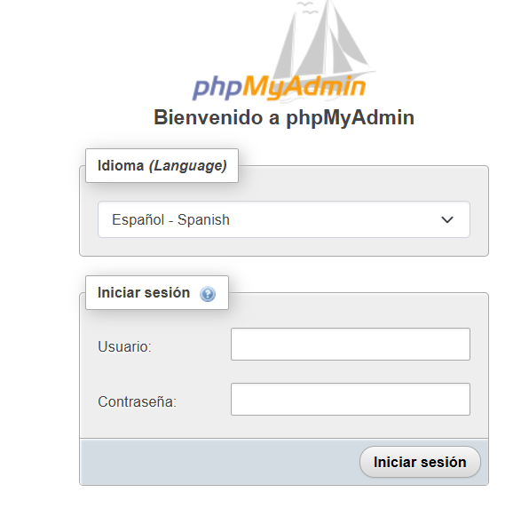
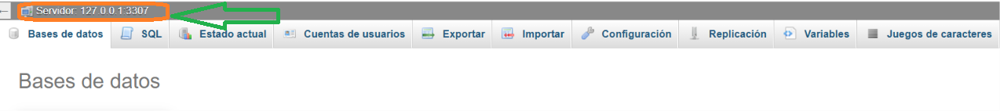
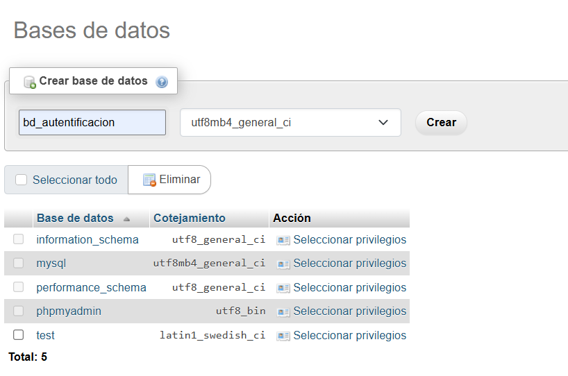

## Para Utilizar xammpp primero vamos a escuchar el puerto 3306
```powershell
Get-NetTCPConnection -LocalPort 3306 -State Listen
```
## Quien lo esta escuchando Consultar el proceso Asociado
```powershell
Get-Process -Id (Get-NetTCPConnection -LocalPort 3306 -State Listen).OwningProcess
```
## 1. Comprueba qué puerto está utilizando mysqld

```powershell
Get-NetTCPConnection -State Listen |
    Where-Object { $_.LocalPort -in 3306,3307 } |
    Select-Object LocalAddress, LocalPort, OwningProcess
```
## Si aparece esto 

LocalAddress  LocalPort  OwningProcess
------------  ---------  -------------
127.0.0.1         3306           6124

## 2. Identifica de dónde viene ese MySQL
```powershell
Get-CimInstance Win32_Process -Filter "ProcessId = 6124" |
    Select-Object ProcessId, ExecutablePath, CommandLine

```
ProcessId ExecutablePath CommandLine
--------- -------------- -----------
     6124  

## Comprueba si pertenece a un servicio de windows
```powershell
Get-CimInstance Win32_Service |
    Where-Object { $_.ProcessId -eq 6124 } |
    Select-Object Name, DisplayName, State, PathName
```

## Si todavia no aparece 
```powershell
3. Si todavía no aparece la ruta
Abre el Administrador de tareas de Windows:
1. Presiona Ctrl + Shift + Esc.
2. Entra en la pestaña Detalles.
3. Busca el PID 6124.
4. Haz clic derecho sobre mysqld.exe.
5. Selecciona Abrir ubicación del archivo, si está disponible.
Así podremos saber si corresponde a XAMPP o a otra instalación de MySQL/MariaDB.

```
Mi recomendación es mantener MySQL Server 8.0 en el puerto 3306 y configurar XAMPP para utilizar el 3307, siempre que quieras mantener ambos servidores funcionando al mismo tiempo.
1. Cambiar el puerto de XAMPP a 3307
Paso 1. Abre XAMPP
En la fila de MySQL, pulsa Config y abre my.ini.
Paso 2. Cambia el puerto
Busca las secciones [client] y [mysqld] y cambia el puerto de 3306 a 3307 en ambas.


## Vas a revisar si estan ok en los dos puertos

```powershell
Get-NetTCPConnection -State Listen |
    Where-Object { $_.LocalPort -in 3306,3307 } |
    Select-Object LocalAddress, LocalPort, OwningProcess
```

## SI ha un error al entrar xamp a mysql en Admin  http://localhost/phpmyadmin/

```bash
Bienvenido a phpMyAdmin

Error
MySQL ha dicho: Documentación

No se estableció la conexión: los parámetros están incorrectos.
 mysqli::real_connect(): (HY000/1045): Access denied for user 'pma'@'localhost' (using password: NO)
 La conexión para controluser, como está definida en su configuración, fracasó.
 mysqli::real_connect(): (HY000/1045): Access denied for user 'root'@'localhost' (using password: NO)
 phpMyAdmin intentó conectarse con el servidor MySQL, y el servidor rechazó esta conexión. Deberá revisar el host, nombre de usuario y contraseña en config.inc.php y asegurarse que corresponden con la información provista por el administrador del servidor MySQL.
```
### Paso 1. Revisa la configuración de phpMyAdmin
1. Abre el panel de control de XAMPP.
2. En la fila MySQL, pulsa Config y abre my.ini. Comprueba el puerto configurado en las secciones [client] y [mysqld]. Anota el valor; normalmente es 3306 o 3307.
3. Abre este archivo con un editor de texto:

```texto sin formato
C:\xampp\phpMyAdmin\config.inc.php

```
### Busca en el servidor
```php
$cfg['Servers'][$i]['auth_type'] = 'config';
$cfg['Servers'][$i]['host'] = 'localhost';
$cfg['Servers'][$i]['user'] = 'root';
$cfg['Servers'][$i]['password'] = '';    
```
### Paso 2. Cambia el método de autenticación
Haz una copia de seguridad de config.inc.php antes de editarlo.
Cambia únicamente el método de autenticación a cookie y agrega la linea del puerto si no existe:
```php
$cfg['Servers'][$i]['auth_type'] = 'cookie';
$cfg['Servers'][$i]['port'] = '3307';

```
Si el archivo tiene configurado el usuario root y una contraseña fija, puedes dejar esas líneas como están por ahora: con el método cookie, phpMyAdmin solicitará las credenciales al iniciar sesión.
Guarda el archivo y reinicia Apache desde XAMPP. No necesitas reiniciar MariaDB si ya está funcionando correctamente.

# Exito esto va entrar SIN CONTRASEÑA



## Configuración del Entorno
```bash
python -m venv venv
```
## Activación del Entorno
```bash
venv\Scripts\activate
```
## Configuración de la Dependencia del entorno
```bash
asgiref==3.12.1
cffi==2.1.1
cryptography==50.0.2
Django==5.0.14
mysqlclient==2.3.0
pycparser==3.11
PyMySQL==1.2.3
sqlparse==0.6.0
tzdata==2026.5
```
## Instalar django y dependencias
```bash
pip install -r requeriments.txt
```
## Crear Proyecto
```bash
django-admin startproject proyecto_autentificacion .
```
## Al crear el proyecto_autentificación, iremos a la carpeta __init__.py, agregamos el código para que salga de la instalación
```bash
import pymysql
```
## Creamos la base de datos manual o con código en sql

```bash
create database bd_autentificacion;
```
# o


## Cambiamos la base de datos con nuestro usuario y contraseña 
```bash
DATABASES = {
    'default': {
        'ENGINE': 'django.db.backends.mysql',
        'NAME':'bd_autentificacion',
        'USER':'root',
        'PASSWORD':'',
        'HOST':'localhost',
        'PORT':'3307',
    }
}
```
## De paso Cambiamos  el idioma

```bash
LANGUAGE_CODE = 'es-cl'

TIME_ZONE = 'America/santiago'

USE_I18N = True

USE_TZ = True

```


## Revisamos si estan correctos los templates
```bash
TEMPLATES = [
    {
        'BACKEND': 'django.template.backends.django.DjangoTemplates',
        'DIRS': [BASE_DIR / 'templates'],
        'APP_DIRS': True,
        'OPTIONS': {
            'context_processors': [
                'django.template.context_processors.request',
                'django.contrib.auth.context_processors.auth',
                'django.contrib.messages.context_processors.messages',
            ],
        },
    },
]
```
## Hacemos la migraciones correspondiente que vienen de auth de django
```bash
python manage.py migrate
```

## Creamo el superusuario
```bash
python manage.py createsuperuser
```
# Por Motivos de aprendizaje y no de seguridad porque la contraseña es demasiada común
```bash
admin
admin@gmail.com
admin1234
y
```

## Creamos las Aplicación
```bash
python manage.py startapp autentificacion_app

```
## Conectamos el proyecto con la aplicacion (autentificacion_app)
```bash
INSTALLED_APPS = [
    'django.contrib.admin',
    'django.contrib.auth',
    'django.contrib.contenttypes',
    'django.contrib.sessions',
    'django.contrib.messages',
    'django.contrib.staticfiles',
    'autentificacion_app',
]

```
## Vamos a crear las vistas en autentificacion_app/views.py
```bash
from django.shortcuts import render
from django.contrib.auth.decorators import login_required

## Creacion de vista

def index(request):
    return render (request, 'autentificacion_app/index.html')

def home(request):
    return render (request, 'autentificacion_app/home.html')

@login_required
def login(request):
    return render (request, 'autentificacion_app/login.html')

```
## Necesito configurar la url en proyecto_autentificacion, voy a urls.py

```bash
from django.contrib import admin
from django.urls import path, include

urlpatterns = [
    path('admin/',admin.site.urls),
    path('',include('autentificacion_app.urls')) 
]
```
## En autentificacion_app creo la urls.py
```bash
from django.urls import path
from django.contrib.auth import views as auth_views
from .import views

urlpatterns = [
    path('login/',auth_views.LoginView.as_view(template_name='autentificacion_app/login.html'),name='login'),
    path('logout/',auth_views.LogoutView.as_view(), name='logout'),
    path('',views.index, name='index'),
    path('home/',views.home, name='home'),
]

```

## Creamos los templates/autentificacion_app/login.html

### login.html
```html
<!DOCTYPE html>
    <html lang="en">

    <head>
        <meta charset="UTF-8">
        <meta name="viewport" content="width=device-width, initial-scale=1.0">
        <title>Login</title>
        <link href="https://cdn.jsdelivr.net/npm/bootstrap@5.3.0/dist/css/bootstrap.min.css" rel="stylesheet">
    </head>

    <body class="bg-light">
        <div class="container mt-5">
            <h1 class="text-center mb-4">Login</h1>
            <div class="card p-4 shadow-sm">
                <form method="post">
                    
                    {{ form.as_p }}
                    <button type="submit" class="btn btn-primary w-100">Login</button>
                </form>
            </div>
        </div>
    </body>
    </html>

```
## Creamos los templates/autentificacion_app/home.html
### home.html
```html
 <!DOCTYPE html>
    <html lang="en">

    <head>
        <meta charset="UTF-8">
        <meta name="viewport" content="width=device-width, initial-scale=1.0">
        <title>Home</title>
        <link href="https://cdn.jsdelivr.net/npm/bootstrap@5.3.0/dist/css/bootstrap.min.css" rel="stylesheet">
    </head>

    <body class="bg-light">
        <div class="container mt-5">
            <h1 class="text-center">Welcome to Home Page</h1>
            <p class="text-center"><a href="" class="btn btn-primary">Login</a></p>
            <p class="text-center"><a href="" class="btn btn-primary">Index</a></p>

        </div>
    </body>

    </html>
```
## Creamos los templates/autentificacion_app/index.html
### index.html
```html
<!DOCTYPE html>
    <html lang="en">

    <head>
        <meta charset="UTF-8">
        <meta name="viewport" content="width=device-width, initial-scale=1.0">
        <title>Home</title>
        <link href="https://cdn.jsdelivr.net/npm/bootstrap@5.3.0/dist/css/bootstrap.min.css" rel="stylesheet">
    </head>

    <body class="bg-light">
        <div class="container mt-5">
            <h1 class="text-center">index HTML</h1>
            
            <h2>Usuario autenticado</h2>
            <p class="text-center">Hello, {{ user.username }}!</p>
            <form method="post" action="" class="text-center">
                
                <button type="submit" class="btn btn-danger">Logout</button>
            </form>
            
            <h2>No tiene permisos para ver esta página</h2>
            <p class="text-center"><a href="" class="btn btn-primary">Login</a></p>
            
        </div>
    </body>
    </html>
```

## Ingreso al proyecto autentificacion setting.py
```bash
STATIC_URL = 'static/'
LOGIN_REDIRECT_URL = '/'
LOGOUT_REDIRECT_URL = '/home'

```


